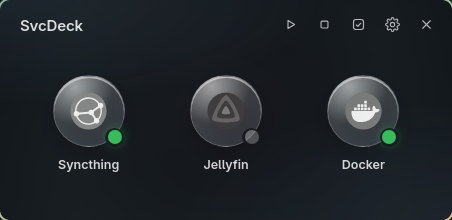

# SvcDeck

**Dienste starten, stoppen und öffnen, die du sonst im Terminal steuerst.**

[English](README.md)

[](https://github.com/bl4z3-0o/svcdeck/actions/workflows/ci.yml)
[](https://github.com/bl4z3-0o/svcdeck/releases/latest)
[](https://aur.archlinux.org/packages/svcdeck-bin)



SvcDeck ist ein kleines schwebendes Fenster mit einer Kachel pro App oder Dienst: eine systemd-Unit, ein Docker-Container, ein Compose-Projekt oder ein beliebiges Shell-Skript. Linksklick öffnet die App im Browser, Rechtsklick zeigt ihre Aktionen (Start, Stop, Status, Logs oder was du selbst festlegst).

- **Jeder Befehl.** Jede Aktion ist ein bash-Befehl, der im Ordner der App läuft. Vorlagen für systemd (Benutzer und System), Docker und Docker Compose füllen Start, Stop, Neustart, Status und Logs automatisch aus.
- **Status auf einen Blick.** Ein Punkt zeigt, ob ein Dienst läuft. Geprüft wird per Befehl (Rückgabewert 0) oder per TCP-Port.
- **Mehrere auf einmal.** Alle Dienste über die Titelleiste starten oder stoppen, oder einzelne Kacheln auswählen und nur diese starten oder stoppen. Dienste, die schon im Zielzustand sind, werden übersprungen.
- **sudo ohne Terminal.** Befehle, die Root brauchen, fragen das Passwort in einem grafischen Dialog ab (rofi, zenity, kdialog oder ssh-askpass).
- **Passt zum Desktop.** Übernimmt unter Hyprland live die HyDE/wallbash-Farben, sonst die Hell/Dunkel-Einstellung des Systems. Englisch und Deutsch.
- **Klein.** Tauri 2 (Rust) mit Svelte-5-Oberfläche, ein einziges Programm von wenigen MB mit dem WebKitGTK des Systems.

## Installation

**Arch Linux und Ableger** (CachyOS, EndeavourOS, Manjaro) aus dem AUR:

```bash
yay -S svcdeck-bin    # fertig gebaut
yay -S svcdeck        # aus dem Quellcode
```

**Debian/Ubuntu und Fedora:** `.deb` und `.rpm` aus dem [neuesten Release](https://github.com/bl4z3-0o/svcdeck/releases/latest).

**Aus dem Quellcode** (jede Distribution mit den [Tauri-Voraussetzungen](https://tauri.app/start/prerequisites/)):

```bash
sudo pacman -S --needed base-devel webkit2gtk-4.1 gtk3 librsvg openssl nodejs npm rustup
rustup default stable

git clone https://github.com/bl4z3-0o/svcdeck.git
cd svcdeck
./install.sh
```

`install.sh` installiert nur für den aktuellen Benutzer (ohne Root): `~/.local/bin/svcdeck`, ein Icon und einen Starter-Eintrag. Danach **SvcDeck** im App-Starter öffnen.

### Updates

SvcDeck fragt beim Start bei GitHub nach einem neueren Release und zeigt dann einen Hinweis. Installiert wird nie etwas automatisch: aktualisiere über den Paketmanager (`yay -Syu`) oder bei Quellcode-Installationen mit `git pull && ./install.sh`. Die Prüfung schickt eine einzige Anfrage an `api.github.com` (GitHub sieht dabei deine IP-Adresse) und lässt sich unter Einstellungen → Allgemein abschalten.

| Option | Wirkung |
|---|---|
| `--skip-build` | vorhandenen Release-Build installieren |
| `--yes` | vor Änderungen an der Compositor-Konfiguration nicht nachfragen |
| `--uninstall` | SvcDeck entfernen (deine Konfiguration bleibt) |

### Kachelnde Compositoren

Auf kachelnden Compositoren soll das Fenster schweben. Das erledigt `install.sh`:

- **Hyprland (Lua-Konfiguration, ab 0.55):** schreibt `~/.config/hypr/svcdeck.lua` und ergänzt nach Rückfrage `require("svcdeck")` in `hyprland.lua`.
- **Hyprland (`hyprland.conf`), Sway, i3, niri:** zeigt die Regel an, die du eintragen musst.
- **GNOME, KDE Plasma und andere schwebende Desktops:** nichts zu tun.

Die Fensterklasse ist `svcdeck`. Terminals, die SvcDeck öffnet, bekommen `svcdeck-term`, sofern das Terminal das unterstützt.

## Konfiguration

Alles lässt sich in der App bearbeiten (Zahnrad). Die Datei liegt unter `~/.config/svcdeck/apps.json`. Ein Beispiel und alle Felder stehen in der [englischen README](README.md#configuration).

Kurz zusammengefasst:

- `url`: wird per Linksklick geöffnet; leer = Linksklick führt die erste Aktion aus
- `icon`: Bildpfad oder Icon-Name aus deinem Icon-Theme; leer = `glyph` oder Standard-Icon
- `dir`: Arbeitsverzeichnis aller Aktionen (Standard: Home)
- `healthCommand`: Statusprüfung, Rückgabewert 0 = läuft; hat Vorrang vor `health` (`host:port`)
- `actions[].mode`: `capture` (Ausgabe in SvcDeck) oder `terminal` (eigenes Terminalfenster)
- `terminal`: leer = automatisch erkannt (`$TERMINAL`, kitty, foot, alacritty, wezterm, ghostty, konsole, gnome-terminal, …)

**Alle starten / Alle stoppen** (▶ und ■ in der Titelleiste oder Rechtsklick auf den Hintergrund) führen in jeder App die Aktion mit der ID `start` bzw. `stop` aus; Stop läuft in umgekehrter Reihenfolge. Apps, deren Statusprüfung schon den Zielzustand zeigt, werden übersprungen (Start lässt laufende aus, Stop gestoppte); Apps ohne Statusprüfung laufen immer mit.

**Auswahl:** Der Häkchen-Knopf in der Titelleiste (oder Strg+Klick auf eine Kachel) schaltet den Auswahlmodus ein. Kacheln anklicken, um sie auszuwählen, dann über die Leiste unten nur diese starten oder stoppen. Esc beendet die Auswahl.

### Sicherheit

SvcDeck führt genau die Befehle aus deiner Konfiguration aus, mit deinen Benutzerrechten. Genau dafür ist es da, also behandle `apps.json` wie ein Shell-Skript: Nutze nur Konfigurationen, die du verstehst, und übernimm sie nicht aus unbekannten Quellen. Die Oberfläche schickt nie freie Befehle ans Backend; Aktionen werden per ID in der gespeicherten Datei nachgeschlagen. Statusprüfungen fragen nie nach einem Passwort.

## Entwicklung

Prüfungen und Commit-Regeln stehen in [CONTRIBUTING.md](CONTRIBUTING.md). Abhängigkeiten hält Renovate aktuell, Releases entstehen mit release-please.

```bash
npm install
PATH="$HOME/.cargo/bin:$PATH" npx tauri dev   # mit Live-Reload
npm run check                                  # svelte-check
cd src-tauri && cargo clippy                   # Rust-Lints
```

## Lizenz

[GPL-3.0-or-later](LICENSE). Du darfst SvcDeck nutzen, untersuchen, weitergeben und verändern. Weitergegebene und veränderte Versionen müssen unter der GPL bleiben, mit Quellcode.
